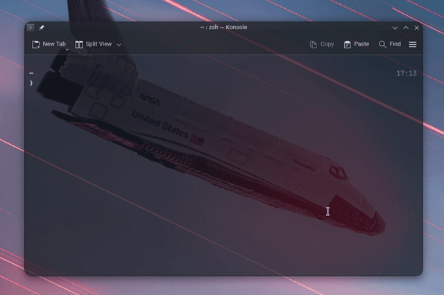
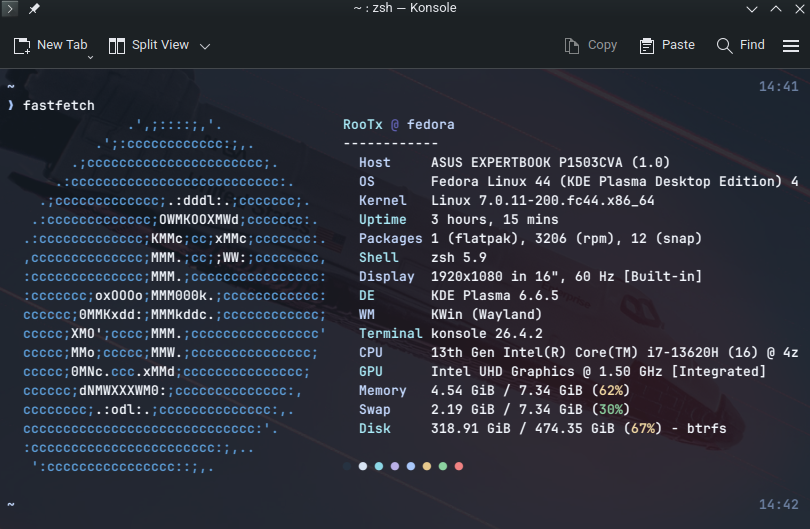
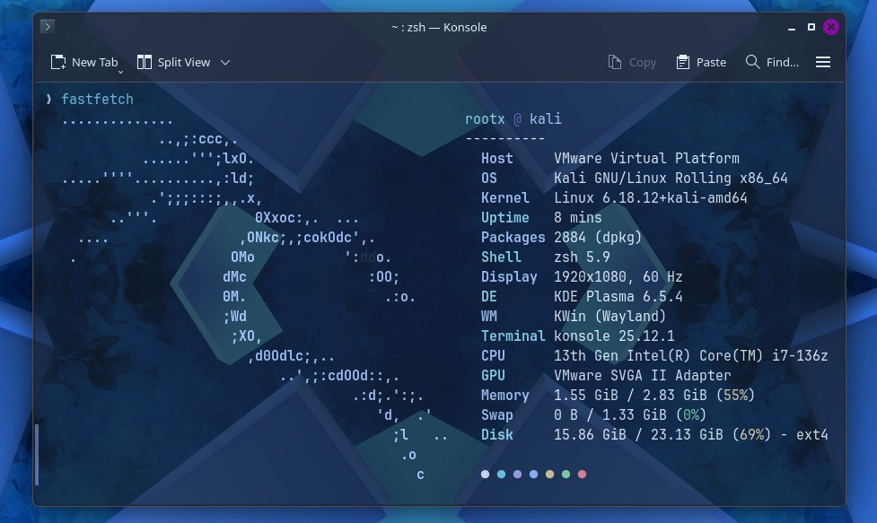
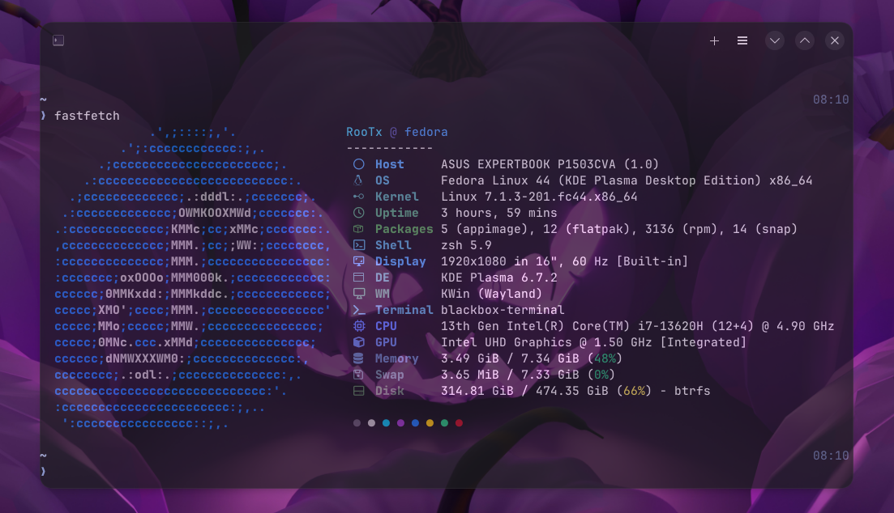

# Darky-Plasma
A clean terminal environment for KDE Plasma (Zsh / Bash)


## Preview

> ---------------------------------------------------------










## Structure 
 ```
Darky/

.
├── bat.txt
├── config.jsonc
├── config-startup.jsonc
├── Darky.profile
├── DarkySlate.colorscheme
├── install.sh
├── LICENSE
├── README.md
├── screenshots
│   ├── fastfetch1.png
│   ├── kali.png
│   ├── konsole.gif
│   └── konsole.png
├── starship.toml
├── uninstall.sh


```


## Installation
> Supports: Arch & Arch-based (Manjaro, EndeavourOS, Garuda, CachyOS, Artix, Parch), Fedora, RHEL-based, Debian/Ubuntu/Kali


> Recommended:`chmod +x install.sh && ./install.sh`


### Manually install:

### 1. Install Font 
```bash
# Fedora / RHEL-based
sudo dnf install jetbrains-mono-fonts-all

# Arch / Arch-based
sudo pacman -S ttf-jetbrains-mono

# Ubuntu / Debian / Kali (or any distro, no package needed)
curl -fsSL https://download.jetbrains.com/fonts/JetBrainsMono-2.304.zip -o /tmp/JetBrainsMono.zip
unzip -oq /tmp/JetBrainsMono.zip -d /tmp/JetBrainsMono
mkdir -p ~/.local/share/fonts/JetBrainsMono
cp /tmp/JetBrainsMono/fonts/ttf/*.ttf ~/.local/share/fonts/JetBrainsMono/
fc-cache -f ~/.local/share/fonts
rm -rf /tmp/JetBrainsMono /tmp/JetBrainsMono.zip
```
### 2. Konsole Theme
```bash
# Copy config files

cp DarkySlate.colorscheme ~/.local/share/konsole
cp Darky.profile ~/.local/share/konsole

# In Konsole: Settings → Manage Profiles → Import
# Or set default: Settings → Edit Current Profile → Darky
```
### 3. Fastfetch
```bash
# Install Fastfetch
# Fedora / RHEL-based
sudo dnf install fastfetch

# Arch / Arch-based
sudo pacman -S fastfetch
# If it is not in your repos (older mirrors / AUR-only setups):
#   yay -S fastfetch

# Ubuntu / Debian / Kali
curl -sL https://github.com/fastfetch-cli/fastfetch/releases/latest/download/fastfetch-linux-amd64.deb -o /tmp/fastfetch.deb
sudo apt install -y /tmp/fastfetch.deb

# Copy config files
mkdir -p ~/.config/fastfetch
cp config.jsonc ~/.config/fastfetch/
cp config-startup.jsonc ~/.config/fastfetch
cp bat.txt ~/.config/fastfetch
```
> For other distros, change `"source": "Fedora"` in config.jsonc to your distro name

### 4. Starship
```bash
# Install (All distros)
curl -sS https://starship.rs/install.sh | sh

# Arch / Arch-based (alternative)
sudo pacman -S starship

# Copy config
cp starship.toml ~/.config/starship.toml

# For Zsh
echo 'eval "$(starship init zsh)"' >> ~/.zshrc

# For Bash
echo 'eval "$(starship init bash)"' >> ~/.bashrc

```

### Arch notes
- Everything except KDE Rounded Corners is supported on Arch. That effect is installed from a Fedora COPR repo, so the installer skips it on Arch — use the AUR package instead:
  ```bash
  yay -S kwin-effect-rounded-corners-git
  ```
- The installer uses `pacman -S --needed --noconfirm` and refreshes the database (`pacman -Sy`) automatically if a package is not found.
- Prefer a full system upgrade before installing: `sudo pacman -Syu`

## License
MIT
